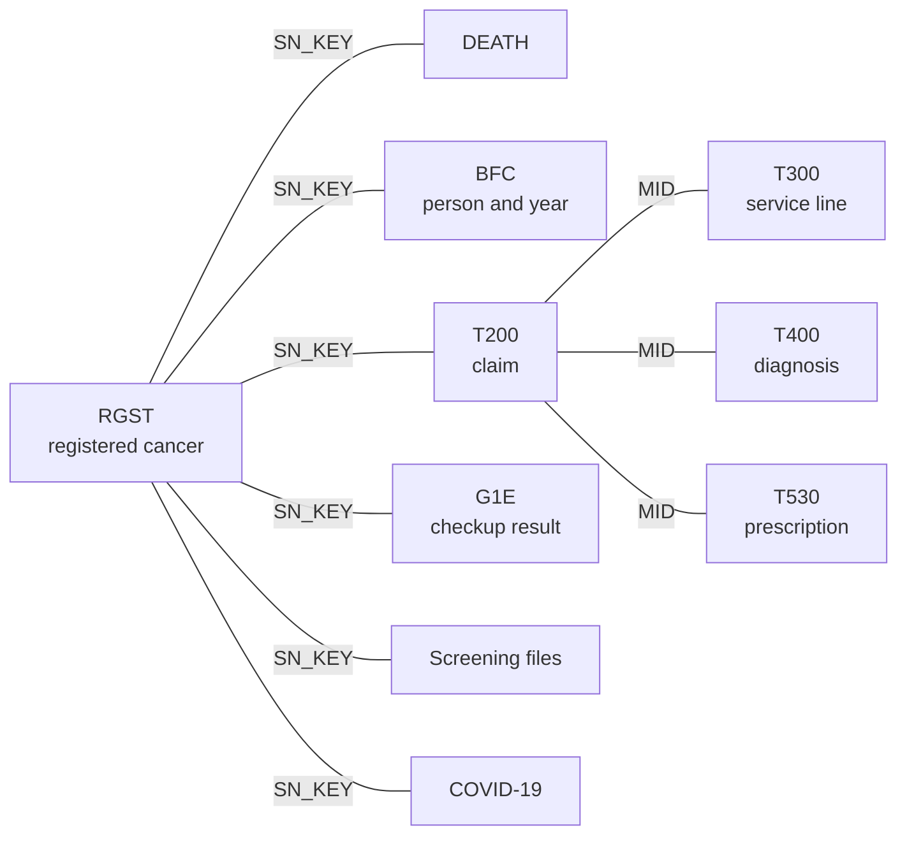

# How the K-CURE tables fit together

The Cancer Public Library (암 공공 라이브러리) arrives as a set of separate tables. A project that follows a person from screening through diagnosis, treatment, and death starts by joining those tables. This post says what one row of each table stands for, names the person identifier, and lists the joins that connect the tables. The variable lists are in [Variables](../../variables/index.md). The table pages are under [Cancer Public Library](../../datasets/public-library/index.md).

<!-- more -->

## What one row stands for

The library is one database. A [customized extract](../../datasets/public-library/index.md) uses the tables below. A [site sample and a staging sample](../../datasets/public-library/sample.md) are separate databases, with their own file names and shorter column lists. Several files are the same kind of record split by year, because the questionnaire changed. Those year files still identify a person with the same key.

| Tables | 한글 | One row |
|---|---|---|
| [`RGST`](../../datasets/public-library/rgst.md) | 암등록 | One registered cancer, 2012–2022. A person with two cancers has two rows |
| [`DEATH`](../../datasets/public-library/death.md) | 사망 | One death, 2012–2023. A person who is alive has no row |
| [`BFC`](../../datasets/public-library/bfc.md) | 자격 및 보험료 | One person in one year, 2007–2024, if that person still had eligibility on 31 December |
| [`T200`](../../datasets/public-library/t200.md) | 명세서 일반내역 | One claim, 2007–2024 |
| [`T300`](../../datasets/public-library/t300.md) | 진료내역 | One service line on a claim |
| [`T400`](../../datasets/public-library/t400.md) | 상병내역 | One diagnosis on a claim |
| [`T530`](../../datasets/public-library/t530.md) | 원외처방내역 | One outpatient prescription line |
| [`G1E_OBJ`](../../datasets/public-library/g1e-obj.md) | 일반건강검진 대상자 | One person in the checkup target file for an examination year |
| `G1Q_0708`, `G1Q_0917`, `G1Q_1824` | 일반건강검진 문진 | One checkup questionnaire. The file is 2007–2008, 2009–2017, or 2018–2024 |
| [`G1E`](../../datasets/public-library/g1e.md) | 일반건강검진 결과 | One checkup result, 2007–2024 |
| `CQ`, and `CBR`, `CCR`, `CCX`, `CLV`, `CST` | 암검진 | One screening record. Each site has a 2007–2008 file and a 2009–2024 file. `CQ` holds the questionnaire items shared across sites |
| [`COVID_PT`](../../datasets/public-library/covid-pt.md) | 코로나19 확진자 | One confirmed case, 2020 through 31 August 2023 |
| [`COVID_VAC`](../../datasets/public-library/covid-vac.md) | 코로나19 예방접종 | One vaccination, 17 December 2020 through 31 August 2023 |

`T200` is the hub of the claims. It carries the person, the start and end of care, the provider, and the reviewed amounts. `T300`, `T400`, and `T530` add the lines of that claim.

## The person identifier

The person identifier is `SN_KEY` (대체식별키).

| Variable | 한글 | English | Where it appears |
|---|---|---|---|
| `SN_KEY` | 대체식별키 | Person identifier | Every table in the Cancer Public Library |

Dictionary version 4.0, section 10, links the whole file from the five institutions on this substitute identifier: cancer registration, death, eligibility and premium, health examinations, cancer screening, and COVID-19, and the claims tables as well. It is the first variable on each list in [Variables](../../variables/index.md). The page for the cancer-registration copy is [here](../../variables/public-library/rgst/sn_key.md).

Two facts about `SN_KEY` decide how a merge behaves.

- A person with two registered cancers has two rows on `RGST` and the same `SN_KEY` on both. Joining `RGST` to another table on `SN_KEY` repeats the other table's rows once for each cancer.
- The quality-control section of the dictionary says each table's substitute identifier is replaced with a new serial number every time the data are extracted. An `SN_KEY` from one extract does not identify the same person in another extract.

## The other keys

`SN_KEY` finds the person. The other keys find the record when one person has many rows.

| Variable | 한글 | English | Where it appears | What it joins |
|---|---|---|---|---|
| `MID` | 명세서조인키 | Claim join key | `T200`, `T300`, `T400`, `T530` | The lines of one claim |
| `STD_YYYY` | 기준연도 | Reference year | `BFC` | The eligibility row for that person in that year |
| `EXMD_BZ_YYYY` | 검진사업연도 | Examination year | Checkup and screening tables | The examination in that year, and which year file to use |

## Joins that cover most analyses

- **A person across the library.** Join any table to any other table on `SN_KEY`. Death, province of residence (`BFC.SIDO_CD`), and the registry stage (`RGST.SEER_GRP`) all meet on that key.
- **The lines of a claim.** Join `T300`, `T400`, and `T530` to `T200` on `MID` (명세서조인키). The dictionary describes `MID` as the substitute identifier that builds one claim from the four tables. Dates of care, the provider, and the reviewed amounts sit on `T200`, so a service line or a diagnosis reaches them through `MID`.
- **Eligibility for the year of a claim.** `BFC` has one row per person per year, in `STD_YYYY`. `T200` dates the claim with `RECU_FR_DD` (요양개시일자). Match `SN_KEY`, and match the year of `RECU_FR_DD` to `STD_YYYY`.
- **A checkup.** The questionnaire for 2018–2024 is `G1Q_1824`, for 2009–2017 is `G1Q_0917`, and for 2007–2008 is `G1Q_0708`. The measured results are on `G1E` for the whole period. Join the questionnaire file for that year to `G1E` on `SN_KEY` and `EXMD_BZ_YYYY`.
- **A cancer screening.** The site file (`CBR`, `CCR`, `CCX`, `CLV`, or `CST`) joins to the shared questionnaire `CQ` on `SN_KEY` and `EXMD_BZ_YYYY`, using the 2007–2008 pair or the 2009–2024 pair.
- **COVID-19.** `COVID_PT` and `COVID_VAC` join to the registry on `SN_KEY`. Vaccination has one row per dose, so a person can have several rows.

## Joining two claim-detail tables

`T300`, `T400`, and `T530` each have many rows for one `MID`. Joining `T300` to `T400` on `MID` pairs every service line with every diagnosis on that claim. A claim with three diagnoses and ten service lines becomes thirty rows, and a sum of service-line amounts is then counted three times.

The pattern that keeps one row per claim is to collapse each detail table first, for example to an indicator for a diagnosis or a total amount per `MID`, and then join that result to `T200`. A join that adds information about claims should leave the number of claims unchanged. Counting the rows before and after the join is the check.
