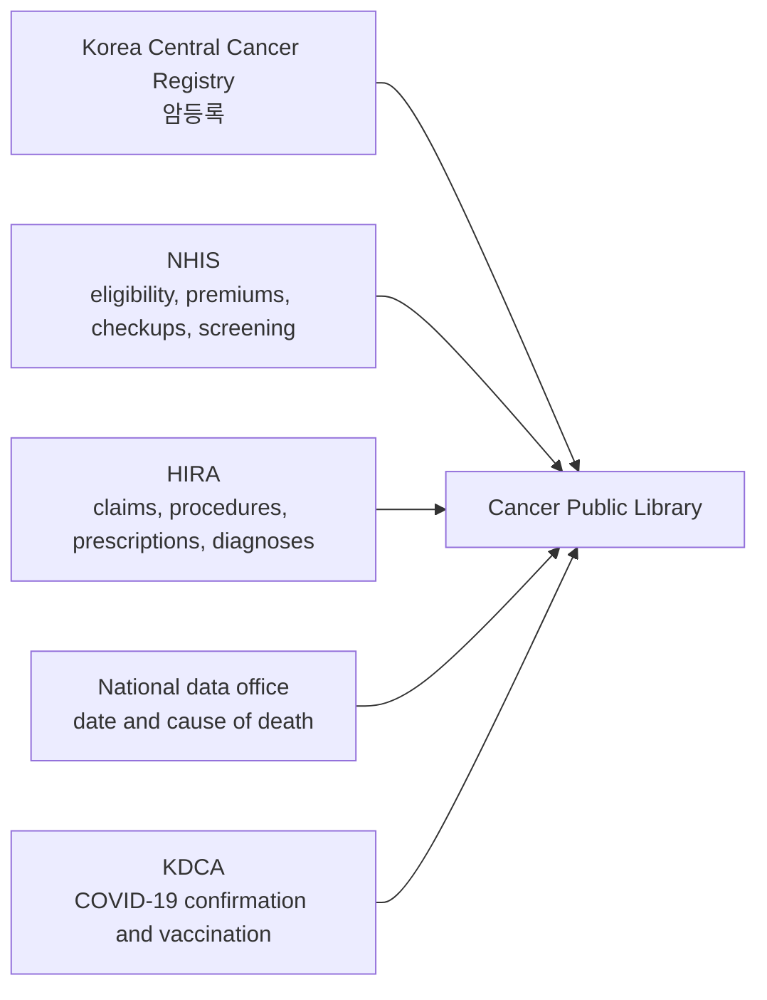

# Cancer Public Library (암 공공 라이브러리)

The Cancer Public Library links the national cancer registry to death records, health-insurance eligibility, general health examinations, national cancer screening, health-insurance claims, and COVID-19 records. The portal calls it a full-cycle history (전주기 이력관리형), because it covers care before diagnosis, the diagnosis itself, treatment, and death. This page describes the customized extract. The [sample page](sample.md) describes the site samples and staging samples.

!!! abstract "At a glance"
    - **[Cohort](#who-is-in-the-library).** Every cancer registered from 2012 through 2022, about 2.92 million registrations, with a person counted once per cancer.
    - **[Years](#tables).** Claims, eligibility, checkups, and screening run from 2007 through 2024, so the years before a diagnosis are observed. Deaths run through 2023.
    - **[Linkage](#how-the-files-are-linked).** Every table joins on `SN_KEY`, and the four claims tables also join on `MID`.
    - **[Limits](#what-the-library-cannot-measure).** The library has no cancer-free controls, no uninsured care, and no laboratory values beyond the checkup and screening results.

??? info "Sources"
    The definition and the source institutions follow the portal's [public-library overview](https://k-cure.mohw.go.kr/portal/dit/plb/inf/viewPlbInfo.do). The cohort, the table list, and the years follow data dictionary version 4.0 (September 2026, describing the build as of June 2026). The linkage method and the limits follow the data resource profile by Choi and colleagues.[^choi]

## Who is in the library

Membership is a row on [`RGST`](rgst.md), the registry table. The cohort is cancers registered from 2012 through 2022, about 2.92 million registrations. A person with two primary cancers (다중원발암) is counted twice and has two rows on `RGST`.

People who were never registered with cancer are absent, so the library has no cancer-free comparison group. Counts from the library also differ from the registry's published incidence: the diagnosis years are fixed, and a person with two cancers contributes two rows.

## Tables

Every table joins on `SN_KEY` (대체식별키). The four claims tables also join to each other on `MID` (명세서조인키).

| Table | Code | Years | Source |
|---|---|---|---|
| [Cancer registration](rgst.md) | `RGST` | 2012–2022 | Korea Central Cancer Registry |
| [Death](death.md) | `DEATH` | 2012–2023 | National data office |
| [Eligibility and premium](bfc.md) | `BFC` | 2007–2024 | NHIS |
| [Claim statement](t200.md) | `T200` | 2007–2024 | HIRA |
| [Services](t300.md) | `T300` | 2007–2024 | HIRA |
| [Diagnoses on the claim](t400.md) | `T400` | 2007–2024 | HIRA |
| [Outpatient prescriptions](t530.md) | `T530` | 2007–2024 | HIRA |
| [General checkup target](g1e-obj.md) | `G1E_OBJ` | 2007–2024 | NHIS |
| [Checkup questionnaire](g1q-0708.md) | `G1Q_0708` | 2007–2008 | NHIS |
| [Checkup questionnaire](g1q-0917.md) | `G1Q_0917` | 2009–2017 | NHIS |
| [Checkup questionnaire](g1q-1824.md) | `G1Q_1824` | 2018–2024 | NHIS |
| [Checkup results](g1e.md) | `G1E` | 2007–2024 | NHIS |
| [Cancer screening questionnaire](cq-rst-0708.md) | `CQ_RST_0708` | 2007–2008 | NHIS |
| [Cancer screening questionnaire](cq-rst-0924.md) | `CQ_RST_0924` | 2009–2024 | NHIS |
| Breast screening | [`CBR_RST_0708`](cbr-rst-0708.md), [`CBR_RST_0924`](cbr-rst-0924.md) | 2007–2008, 2009–2024 | NHIS |
| Colorectal screening | [`CCR_RST_0708`](ccr-rst-0708.md), [`CCR_RST_0924`](ccr-rst-0924.md) | 2007–2008, 2009–2024 | NHIS |
| Cervical screening | [`CCX_RST_0708`](ccx-rst-0708.md), [`CCX_RST_0924`](ccx-rst-0924.md) | 2007–2008, 2009–2024 | NHIS |
| Liver screening | [`CLV_RST_0708`](clv-rst-0708.md), [`CLV_RST_0924`](clv-rst-0924.md) | 2007–2008, 2009–2024 | NHIS |
| Stomach screening | [`CST_RST_0708`](cst-rst-0708.md), [`CST_RST_0924`](cst-rst-0924.md) | 2007–2008, 2009–2024 | NHIS |
| [COVID-19 cases](covid-pt.md) | `COVID_PT` | 2020–31 Aug 2023 | KDCA |
| [COVID-19 vaccination](covid-vac.md) | `COVID_VAC` | 17 Dec 2020–31 Aug 2023 | KDCA |

## How the files are linked

Each source institution creates a linkage key from the resident registration number (주민등록번호), using a secure hash and a salt supplied for the project. A linkage table joins those keys, and the National Cancer Data Center builds the library from it and then deletes it. The released files carry one non-identifying person number, `SN_KEY`, so the same person can be followed across tables and years.

`SN_KEY` is reassigned at every extraction, so it identifies a person only within one extract. Researchers cannot link another person-level file themselves. The joins are described in the research note on [how the tables fit together](../../blog/posts/01-how-the-kcure-tables-fit-together.md).

## What the library cannot measure

- Care outside national health insurance, such as over-the-counter drugs and uncovered services.
- Images, laboratory values, and biomarkers, except the results recorded on the checkup and cancer-screening tables.
- Sensitive conditions, including mental illness, suicide, sexually transmitted diseases, and miscarriage, which are removed or masked.
- Whether another disease occurred. Diagnoses other than the registry cancer are billing codes.
- Patient-reported outcomes and the reasons for a treatment choice.

[^choi]: Choi DW, et al. Data Resource Profile: The Cancer Public Library Database in South Korea. *Cancer Research and Treatment*. 2024;56(4):1014-1026. [doi:10.4143/crt.2024.207](https://doi.org/10.4143/crt.2024.207)
